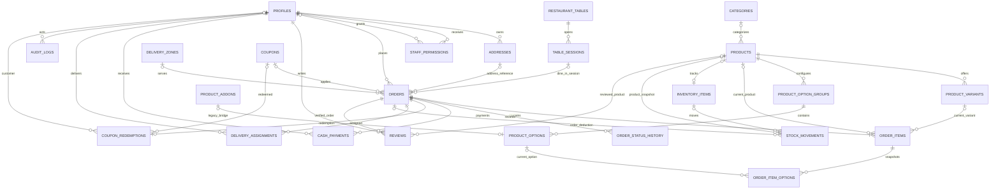

# Pizza Station database relationships

## Relationship notes

- `profiles` is keyed to Supabase Auth users. A profile can own addresses and
  customer orders, or receive granular entries in `staff_permissions`.
- A product belongs to an optional category and can have variants and option
  groups. Each group owns its selectable options. `product_addons` is retained
  for compatibility with the current API; database triggers keep those rows
  synchronized with the normalized `product_options` catalog.
- An order has a nullable customer for guest checkout. It snapshots customer
  delivery details in `delivery_address_snapshot`, links an optional saved
  address, and references a delivery zone, coupon, and/or dine-in table session.
  Its `order_items` store product and variant snapshots; `order_item_options`
  store each selected option's name, group, price, and quantity snapshot.
- `order_status_history`, `cash_payments`, `coupon_redemptions`, and
  `delivery_assignments` record order lifecycle events separately from the
  current order status and payment status.
- A restaurant table stores its QR secret as the unique SHA-256
  `qr_token_hash`; raw QR tokens are never stored. A table can have historical
  sessions but at most one session without an `ended_at` timestamp. Each
  session's separate internal `token_hash` is also private. Public table reads
  are disabled; a security-definer validator returns only the table label after
  checking the QR, table activation, and current session.
- Inventory is one current `inventory_items` row per product, with immutable
  `stock_movements` recording quantity deltas and optional order references.
- `restaurant_settings` is keyed by setting name and marks each value public or
  private. `audit_logs` records selected administrative table changes.

The original `settings`, `payment_records`, `inventory_movements`,
`dining_tables`, and `product_addons` tables remain in place as compatibility
sources for the existing application. Migration 002 copies applicable rows and
bridges writes; it does not drop those legacy tables. Migration 003 adds
table-level QR hashes and synchronizes the legacy `dining_tables` rows needed
by the existing atomic order function.
